# IMACASA · PC10 Montaje · Equipo Planta (G2)

Checkpoint 1 de *Ingeniería de la IA* (PBL): inspección visual de defectos asistida por IA en la línea de machetes de IMACASA.
Esta carpeta contiene **todo lo construido** (UI completa + servicio Docker + imágenes demo) y la **guía para que el equipo escriba el PDF** (`CP1_Equipo##_PC10.pdf`, máx. 10 páginas sin referencias).

> **Lee primero:** qué está hecho, qué falta, y las 6 cosas que hay que confirmar (sección 9).

## 1. Estado

| Pieza | Estado | Dónde |
|---|---|---|
| UI con login, tiempo real, 3 estaciones, historial filtrable | **Hecha** y verificada (9 tests backend, typecheck, 11 capturas automáticas) | `01-ui/` |
| Servicio mock Docker (`/health`, `/info`) | **Hecho**, probado local y por túnel público | `05-mock-service/` |
| Imágenes demo (241) | **Hechas** (simuladas, ver sección 7) | `01-ui/backend/seed/` |
| Túnel ngrok con URL fija | **Pendiente:** ngrok instalado, falta el *authtoken* | `05-mock-service/run-tunnel.sh` |
| PDF: análisis de defectos, modelos, arquitectura, redacción | **Lo escribe el equipo** con este README como base | secciones 3-6 |
| Portada (nº de equipo, integrantes, URL, credenciales) | Placeholder | `report/cover.md` |

## 2. Cómo correrlo

**Un solo clic en Windows:** abre [`iniciar-todo.bat`](iniciar-todo.bat) para levantar Docker (`05-mock-service`), la UI (`01-ui`) y el túnel público automáticamente (y [`detener-todo.bat`](detener-todo.bat) para apagar todo). También hay lanzadores individuales en `01-ui\iniciar-ui.bat`, `05-mock-service\iniciar-mock-docker.bat`, `05-mock-service\iniciar-tunel.bat` e `iniciar-tunel-backup.bat`.

```bash
# UI (un solo proceso: API + SPA)         ->  http://127.0.0.1:8100
./01-ui/run.sh
#   usuarios demo:  yo / yo                         (acceso rápido, administrador)
#                   admin / Planta-Admin-2026       (puede iniciar/detener el simulador)
#                   operador / Planta-Operador-2026
# Desarrollo con recarga: backend `uv run uvicorn app.main:app --port 8100`; frontend `pnpm dev` (http://localhost:5173, proxy a 8100)

# Servicio mock (Docker) + túnel         ->  ver 05-mock-service/README.md
cd 05-mock-service && cp .env.example .env && docker compose up --build -d
```

Requisitos: Docker Desktop con integración WSL, `uv`, Node 24 + `pnpm`. Los datos de la UI se regeneran borrando `01-ui/backend/data/`.

## 3. Mapa del PDF: qué escribir y qué evidencia ya existe

| Req. | Pts | Qué debe decir el PDF | Evidencia / material en este repo |
|---|---|---|---|
| 4. Defectos e imágenes | 25 | Tabla de 8 filas + protocolo de captura | Sección 4 (propuesta inicial argumentada) |
| 1. UI | 20 | Auth, tiempo real, 3 estaciones, historial, justificación web | Sección 5 + `01-ui/screenshots/` |
| 3. Modelos | 20 | ≥ 3 candidatos con **referencias reales** | Sección 6 (solo orientación; **hay que investigar y citar**) |
| 2. Arquitectura | 15 | Diagrama, servicios justificados, cámara/iluminación/soporte | Sección 6 (diagrama base) |
| 5. Docker + túnel | 15 | Dockerfile, comando, capturas 200/401, **en vivo** | `05-mock-service/` |
| Calidad | 5 | Claridad, capturas legibles, referencias | |

Criterio central que se califica: **decidir y justificar cada punto** (CV 2D / CV con captura especial / instrumento). "Todo con CV" o "todo con YOLO" cuenta como análisis incompleto.

## 4. Req. 4 · Los 8 puntos de Montaje (PC10)

La columna *Viabilidad* de la tabla del PDF. **Es una propuesta inicial; el equipo debe discutirla y ajustarla.** El mismo catálogo está cargado en la UI (`01-ui/backend/app/catalog.py`), así que si cambian algo aquí, cámbienlo también ahí.

| Punto | Viabilidad | Tarea ML | Por qué / qué captura necesita | Alternativa si no es CV |
|---|---|---|---|---|
| Largo fuera de tolerancia | **Captura especial** | Medición (segmentación de la hoja + conversión píxel→mm) | Una foto sola no da milímetros: hace falta vista cenital, cámara fija a distancia conocida, **referencia de escala** y calibración. Precisión limitada por resolución: con ~2.5 px/mm en la demo, 1 px ≈ 0.4 mm. | Regla / galga |
| Ancho fuera de tolerancia | **Captura especial** | Medición en una sección fija de la hoja | Misma captura que el largo; se mide en una sección fija (la demo usa x = 700 px). Contraste de fondo para segmentar bien el borde. | Calibrador |
| Espesor fuera de medida | **Instrumento** | No aplica | Es la dimensión en el eje de la cámara: desde arriba no se ve. Solo con vista de perfil + óptica telecéntrica sería posible, y no compensa para una tolerancia de décimas de mm. | Calibrador/micrómetro; la UI lo registra con el formulario "Registro por instrumento" |
| Mal acabado | **CV en foto 2D** (iluminación difusa) | Detección de anomalías (p. ej. enfoques tipo PatchCore) o segmentación, según cómo se defina | Aplica a **cuchilla y cacha**. Hoja: rayaduras, mellas/rebabas en el filo, picaduras con óxido, golpes, pulido irregular. Cacha: astillas, lijado burdo. Hay que **definir qué es "mal acabado"** con IMACASA. Pocos ejemplos defectuosos → anomalías entrenadas solo con piezas OK. | — |
| Mal ajuste | **Captura especial** | Detección / medición de la holgura | Holgura en la unión hoja-cacha: requiere vista cercana y luz controlada (a veces lateral) para ver la rendija. | Galga de espesores |
| Mal remachado | **CV en foto 2D** (alta resolución) | Detección de remaches + clasificación del recorte | Remache pequeño (≈ 17 px en la demo): hace falta resolución suficiente, mejor 2 etapas (localizar 3 remaches → clasificar cada recorte). | — |
| Remaches con óxido | **CV en foto 2D** | Clasificación sobre recorte (puede compartir etapa con "mal remachado") | Es color/textura; visible en 2D. Cuidado con confundir óxido con sombras/madera: iluminación difusa y balance de blancos fijo. | — |
| Desface de cacha | **Captura especial** | Medición geométrica (ángulo/desplazamiento respecto al eje de la hoja) | Es geometría, no apariencia: vista cenital calibrada; si el desface es en altura, vista de perfil. **Compartido con PC12 Inyectado.** | Galga / plantilla |

**Un mismo modelo cubre varios puntos** (el enunciado pide decirlo): un detector/segmentador de piezas y remaches sirve para largo, ancho, desface, mal remachado y óxido (con distintos "cabezales"); la detección de anomalías cubre mal acabado.

### Número de imágenes (solo los puntos resolubles con CV)

Plantilla de razonamiento y **cifras iniciales a validar**. Factores: variabilidad visual (madera, lote de acero, iluminación), tamaño del defecto, desbalance (en planta el defecto es raro: la demo usa ~13 % en PC10), aumentación y división train/val/test.

| Punto | Sin defecto | Con defecto | Razonamiento breve |
|---|---|---|---|
| Remaches con óxido (recortes) | 800 | 400 | Clasificación binaria sobre recortes; 3 remaches por machete multiplican los recortes: ~150 machetes × 3 × 2 tomas. Aumentación suave (brillo, rotación ±5°); **no** cambiar color. |
| Mal remachado (recortes) | 800 | 300 | Defecto más raro y variado (grieta, descentrado, cabeza deformada): se compensa con más negativos y aumentación geométrica. |
| Mal acabado | 600 | 150 | Detección de anomalías entrena solo con OK; los defectuosos se usan para validar/test, no para entrenar. |
| Largo / Ancho / Desface / Mal ajuste | 300 | 120 c/u | Son mediciones: se valida precisión contra instrumento, no se "entrena" una clase. Hacen falta machetes con valores repartidos **dentro y fuera** de tolerancia (si todos son buenos no se puede validar). |

División sugerida **por machete físico, no por imagen** (70/15/15), para que fotos del mismo machete no caigan en train y test a la vez. Protocolo de captura a describir: vista cenital + una vista cercana de la unión cacha/hoja; fondo mate de contraste; difusor/domo sin reflejos; **referencia de escala** visible en cada foto; 2-3 posiciones/orientaciones por machete. Machetes necesarios ≈ `imágenes objetivo / (vistas por machete × tomas)`; con 150 machetes y ~6 tomas útiles salen ~900 imágenes/vista. Inclúyanlo como fórmula con sus números.

## 5. Req. 1 · UI (lo ya construido)

**Web, no app.** Criterios concretos para el PDF: *quién* (operadores en la estación y supervisores/ingeniería), *dónde* (PC o tableta fijos en cada estación PC08/PC10/PC12, y consulta ocasional desde oficina o celular), *con qué dispositivo* (mezcla no controlada: Windows de planta, tabletas, móviles), *despliegue* (un solo servidor, sin instalar ni actualizar en 3 estaciones), *tiempo real* (SSE sobre HTTP, atraviesa proxys y túneles sin configuración) y *costo de mantenimiento*. Una app nativa solo se justificaría con hardware local (p. ej. la cámara en el mismo equipo), que aquí va en un servicio de captura aparte.

Lo que implementa (`01-ui/`):
- **Login** usuario/contraseña (Argon2 + JWT con expiración; mismo error para usuario inexistente y clave incorrecta). Roles `admin` y `operator`.
- **Tablero general** de las 3 estaciones (piezas 24 h, % defectos, última pieza), defectos por día y estación, ranking de defectos, actividad en vivo.
- **Vista en tiempo real por estación** (`/station/PC10`): imagen entrante con *bounding box*, veredicto **OK/Defecto**, tipo de defecto, **confianza**, medición contra tolerancia (largo, ancho, espesor), pieza, modelo y latencia. Botón Congelar/Volver a en vivo, indicador de conexión SSE.
- **Historial filtrable** por estación, fecha, defecto, veredicto y pieza; filtros en la URL; paginación; detalle con imagen.
- **Desface de cacha en dos estaciones:** es **un solo código** (`handle_misalignment`) compartido por PC10 y PC12. Filtrar por él muestra una **comparativa PC10 vs PC12**, y el detalle de cualquier registro muestra "mismo defecto en otra estación". Es lo que pide el enunciado.
- **Registro por instrumento** (solo PC10): el espesor se mide con calibrador y se registra a mano; queda marcado como origen "Manual".
- **Catálogo de defectos** con viabilidad por punto.
- Tema oscuro/claro, responsive (móvil con barra inferior), estados vacío/carga/error, accesibilidad (foco visible, `aria-live`, enlace "saltar al contenido", `prefers-reduced-motion`).
- Lo que **no** es real: la inferencia. Un simulador genera inspecciones (modelo `simulated-v0`) y elige imágenes del pool demo. Para el PDF digan que el contrato (`Inspection`) es el que recibiría el servicio de inferencia real.

Capturas (generadas por `node 01-ui/tools/screenshots.mjs`, que también verifica el DOM, errores de consola y desbordes):

| | |
|---|---|
| 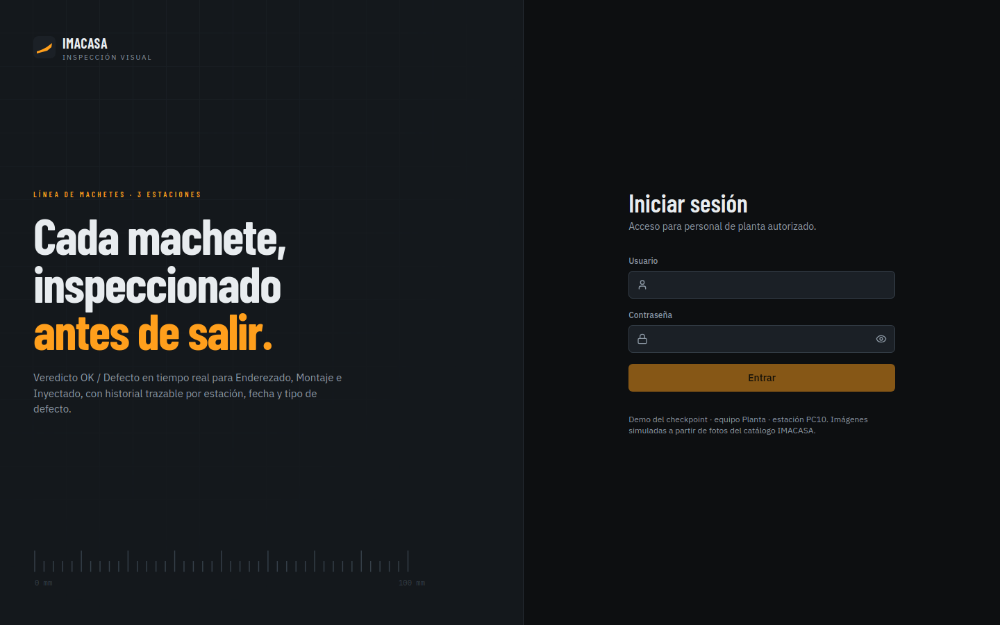 | 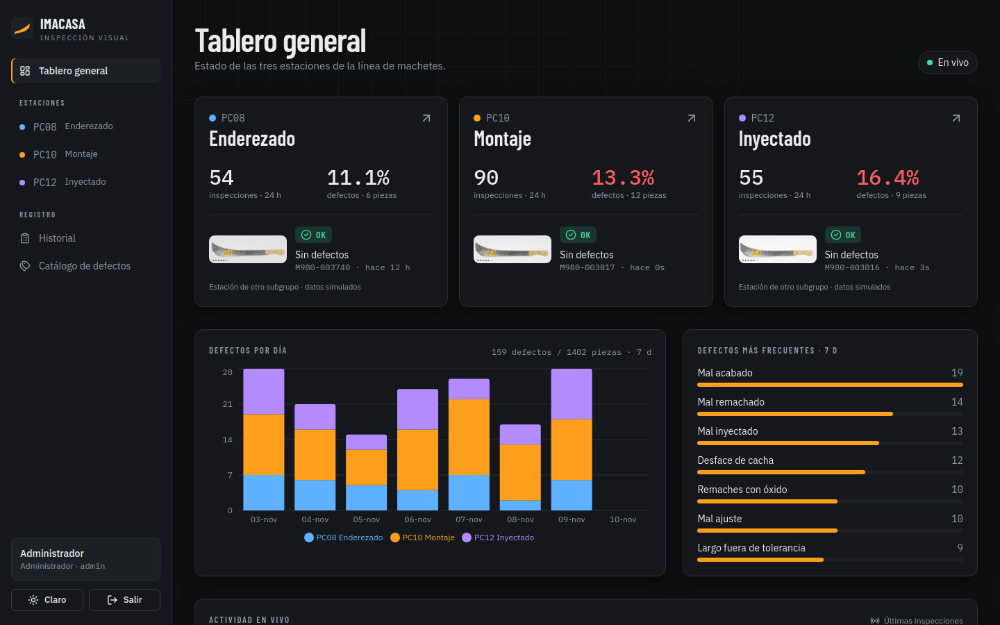 |
| 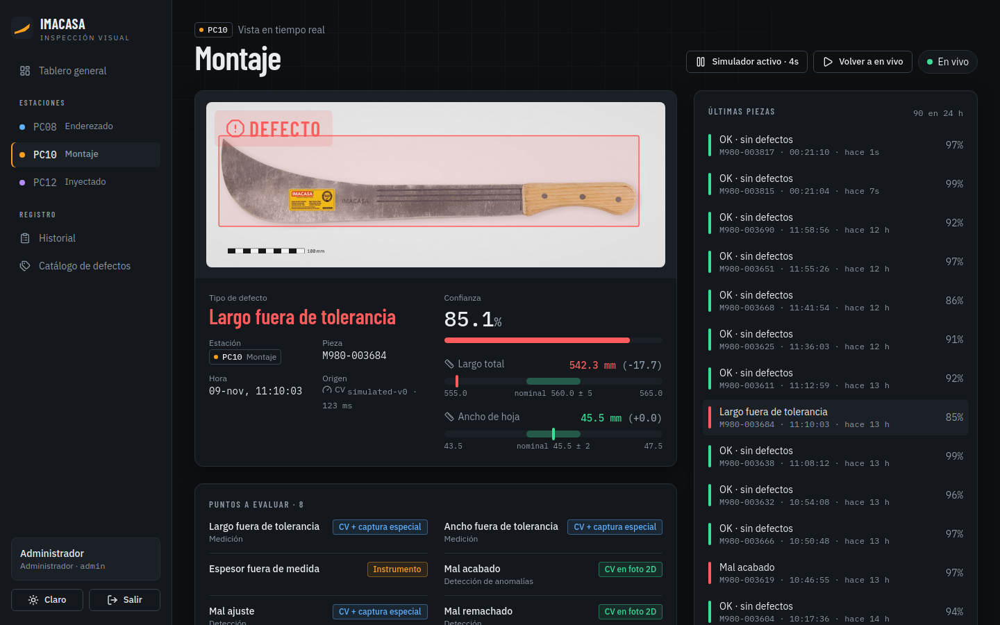 | 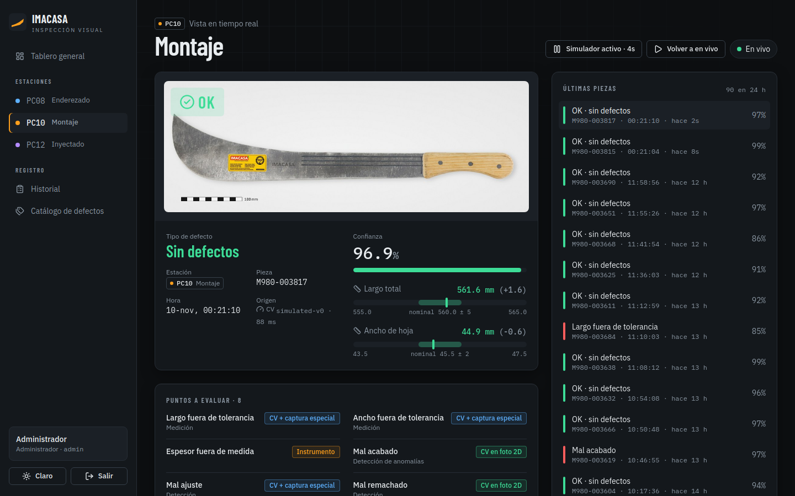 |
| 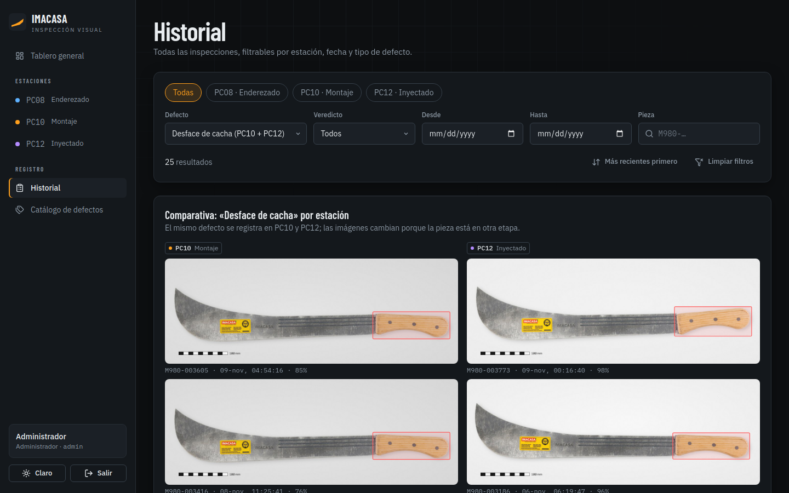 | 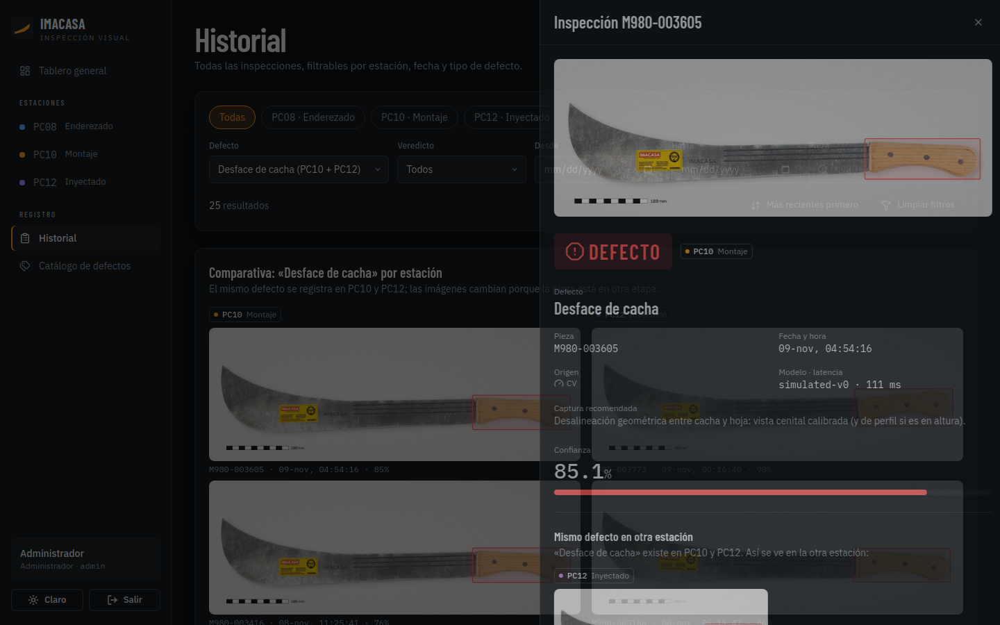 |
| 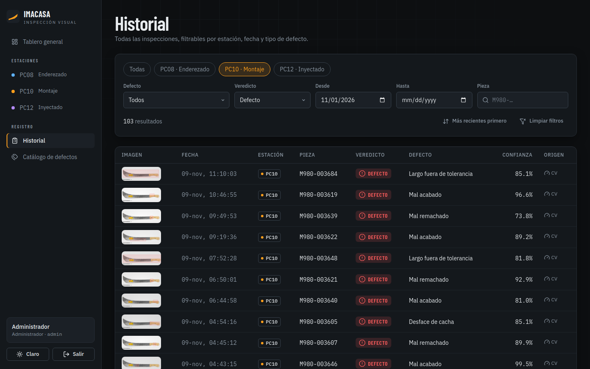 | 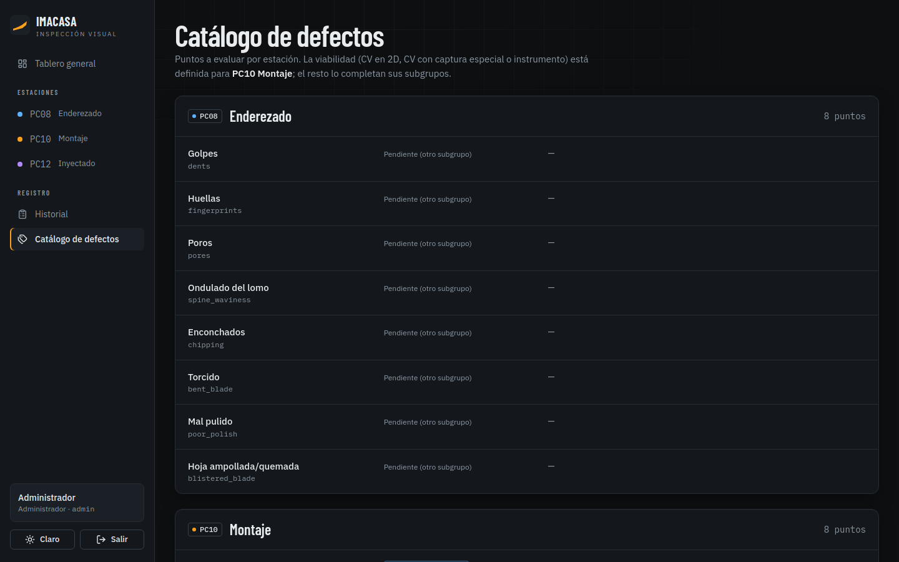 |
| 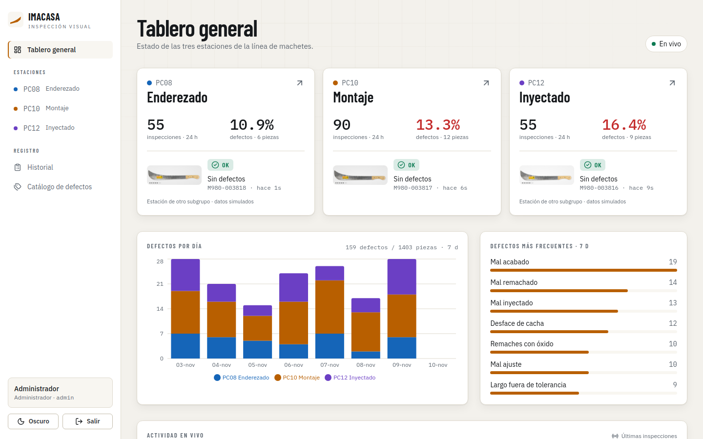 | 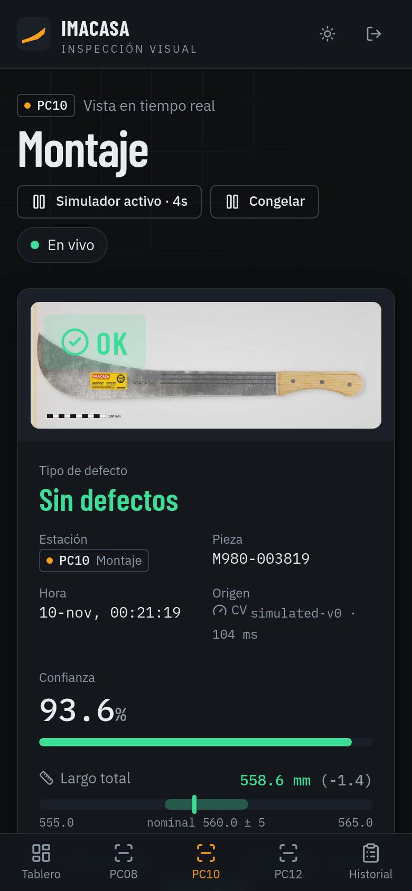 |

Error de login: `02-login-error.png`.

## 6. Req. 2 y 3 · Arquitectura y modelos

**Flujo propuesto (para el diagrama del PDF):**

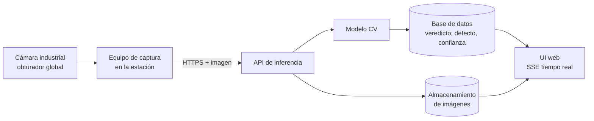

Lo que **está implementado como demo**: simulador → inspecciones en SQLite → API FastAPI → SSE → React. La cámara y el modelo se sustituyen por el simulador. Para el PDF elijan y justifiquen servicios de producción (por ejemplo PostgreSQL en vez de SQLite, almacenamiento tipo S3/MinIO para imágenes, cómputo en el borde vs nube según latencia y ancho de banda, túnel/VPN). Son decisiones del equipo: cada una necesita un *porqué*.

**Captura en planta (concepto):** los puntos con *captura especial* (largo, ancho, mal ajuste, desface) definen la propuesta: cámara **de área** con **obturador global** (pieza en movimiento sobre banda; el obturador rodante deforma), resolución derivada del requisito (para ~0.3 mm de precisión sobre ~600 mm de campo hacen falta ≳ 2000 px de ancho útil; calculen y citen), iluminación difusa/domo estable, fondo mate de contraste, **referencia de escala** fija en el soporte y soporte rígido a distancia constante. *Cámara lineal* es la alternativa si la pieza pasa a velocidad constante. Hay que **investigar y citar modelos de cámara reales**; la cámara no se diseña. El soporte sí se bosqueja.

**Modelos (≥ 3 con referencia, tamaño, latencia, tarea; elegir uno):** el criterio es la *tarea* de cada punto. Familias a investigar, **sin afirmar cifras hasta leer la fuente**:
- Detección (YOLO y variantes recientes, RT-DETR) para remaches y piezas.
- Detección de anomalías sin defectos etiquetados (PatchCore / familia Anomalib, EfficientAD) para mal acabado.
- Segmentación (SAM / modelos de segmentación ligeros) para aislar hoja y cacha antes de medir.
- Clasificación sobre recortes (backbones ligeros preentrenados) para óxido.
Cada candidato debe traer su artículo/model card/benchmark industrial (p. ej. MVTec AD) y mencionar qué puntos cubre.

## 7. Imágenes demo: cómo se hicieron y qué no son

No hay fotos reales de planta. El pool (`01-ui/backend/seed/`, 224 JPEG 1200×432, manifiesto con *bbox* y verdad de terreno) se generó **a partir de la foto de catálogo del Classic 980 de IMACASA** (tienen convenio con ellos):

- **Deterministas (largo, ancho, desface, mal ajuste, OK):** se manipula la geometría de la foto real, así que el *bbox* y los milímetros son exactos por construcción.
- **Difusión local (óxido en remaches, mal remachado, mal acabado en cacha):** Z-Image Turbo (`ia-local`, img2img) sobre un **recorte**; el resto del machete sigue siendo la foto real. Se descartaron los parches que deformaban la silueta.
- **Daño en la cuchilla (mal acabado, 25 de las 33 imágenes de ese defecto):** rayaduras profundas, filo con mellas y rebabas, picaduras con óxido, golpe/raspón y pulido irregular. Son procedurales porque la difusión sobre la hoja salió poco realista y se rechazó. El tipo de daño queda en `notes` y en `truth.note` del manifiesto.
- **Procedurales (PC08 y PC12):** datos de relleno para las estaciones de otros subgrupos.
- Referencia de escala (barra de 100 mm), fondo, luz, ruido y pequeñas rotaciones simuladas.

Importante para el PDF: **son material de demostración simulado, no datos de entrenamiento ni evidencia de rendimiento.** Regenerar: `cd 01-ui/assets-gen && uv run python build_seed.py` (la parte de difusión corre con el entorno de `ia-local`, ver docstring de `diffusion.py`; `data/` no se versiona).

## 8. Estructura

```
01-ui/{backend,frontend,assets-gen,tools,screenshots}   UI completa e imágenes
05-mock-service/                                        Docker + túnel + evidencia
02-architecture, 03-models, 04-defects-analysis         vacías: material para el PDF
report/cover.md                                         portada (placeholder)
.claude/skills/                                         skills de diseño usados en la UI
```

Los skills de diseño (`frontend-design`, `ui-design-brain`, `make-interfaces-feel-better`, `web-design-guidelines`, `impeccable` sin su binario) están en `.claude/skills/`; se descartó Taste Skill (40 MB, hook `Stop`, orientado a landings).

## 9. Por confirmar / supuestos

1. **Nominales y tolerancias son supuestos:** largo 560 mm ±5, ancho de hoja ~45.5 mm ±2, espesor 3.5 mm ±0.3. Pedir la ficha técnica real de IMACASA y corregir `common.py` (generador) y el formulario de espesor.
2. Definición exacta de **"mal acabado"** y de **"mal ajuste"** con IMACASA.
3. Viabilidad de la sección 4 (propuesta inicial).
4. **Authtoken de ngrok** y que el dominio fijo no esté ocupado por otro proyecto.
5. Número de equipo, integrantes, URL y credenciales finales (`report/cover.md`); repetir las capturas del servicio con la URL/token definitivos.
6. Las **credenciales demo de la UI** son para el checkpoint; cambiarlas por variables de entorno (`DEMO_*_PASSWORD`, `JWT_SECRET`) en cualquier despliegue compartido. Las imágenes se sirven sin autenticar (demo); en producción irían con URL firmada.
